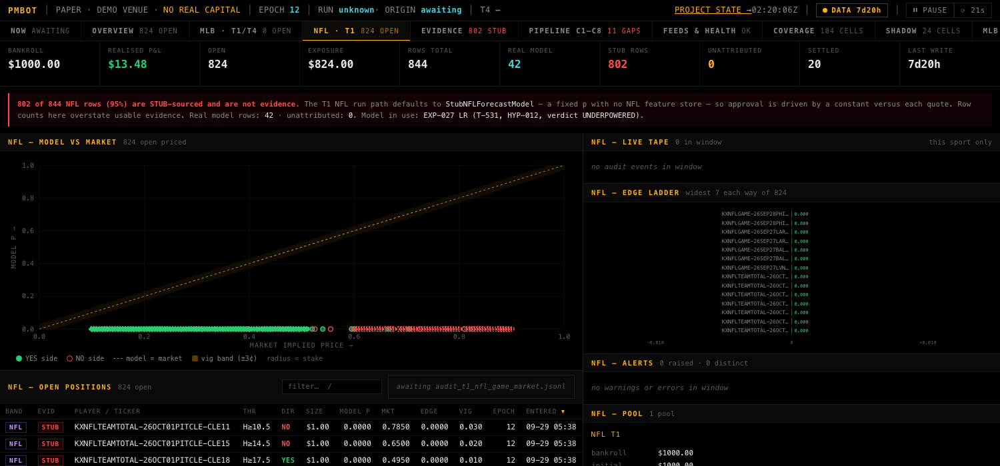
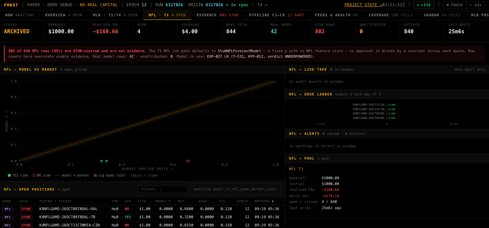
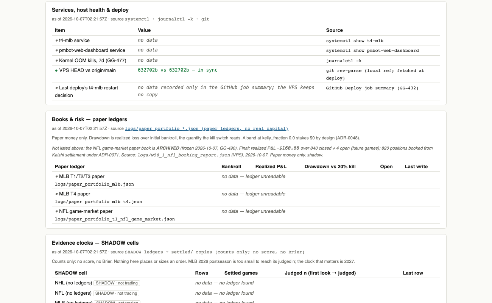

# W58.1 — Every arm logging, every book truthful, gap log shrinking

Session claim T-704..T-707, GG-493..GG-496. Branch: session/20261007T011626Z-w58-1-ops-books-gaps.

## Part A — MLB player-hits proof (GG-489) — DONE
- A1 GG-489 registered (was claimed by W57.1, never written). RESOLVED with evidence below.
- A2 VPS CSV: 51,982 rows, 661 players, max game_date 2026-10-06, 1.8% blank cells, file time 2026-10-07 00:55:40Z. Last writer: GitHub `MLB Features Sync` (workflow_dispatch run 37552551967, 22m44s). Before: 9,890 rows / 82 players / 2026-09-27.
- A3 T1 by hand (exact cron command): exit 0, passed PIPE-05, 12 players / 33 pairs live, 24 edge_decision rows (T1 cell), 0 bets, 21 C4 rejections. T2: no run due until 19:30Z (6 evaluated on 10-05; 0 on 10-06 while features were stale). T3 cron 01:17Z ran with no contract violation (0 CONFIRM/FADE/NEUTRAL signals).
- A4 PIPE-06pre HALTed 10-05 and 10-06 (no output). Re-run by hand: 29 players, 58 markets, 48 actionable, pregame_mlb_20261007.json written.
- A5 AUTHORIZED (queue line verified on origin/main, commit 1cfaace). VPS `30 22 * * *` line commented out; backup crontab_backup_20261007T011803Z_w58_1.txt; diff = one line commented + one comment line; mirrored in deploy/cron.conf.
- A6 GG-489 RESOLVED.

## Part B — NHL goalie timing GH job (GG-401) — DONE
PR #173 merged (CI test pass). `.github/workflows/nhl_goalie_probe.yml`: every 10 min 21:00-03:50 UTC + workflow_dispatch; appends to `data/nhl-goalie-probe:goalie_source_probe.jsonl` (never main); self-stops after 2026-10-14. Dispatched once (run 37557190187, success): 9 records appended. No NHL score read. Verdict rule recorded on GG-401 (status unchanged).

## Part C — NFL game-market book retired (GG-490, ADR-0071)

- C1 survey: book had 844 rows, 20 closed, 824 open (802 STUB-sourced); no cron/service writes it (last write 2026-09-29 hand run).
- C2 booking (VPS, one time): backup `paper_portfolio_t1_nfl_game_market.pre_w58_1_adr0071_20261007T013059Z.json` sha256 `47dab9c8f6888a2f99caa8fecbf3aeaea1908f630e89dd9e402547878144e9d7`. Dry run on a COPY first; live outcomes/pnl identical to dry run.
- 820 positions booked from Kalshi settlement (353 yes, 467 no, 0 cancelled). 4 left OPEN (future games TB/DAL 10-08, CIN/MIA 10-11) — not guessed.
- Realised P&L +13.4778 -> -160.6598 (delta -174.1376 = exact sum of new rows; wins +433.86, losses -608.00). The 20 old closed rows byte-identical. `bankroll_usd` unchanged by the settle path ($1000.00). Disclosed side effect: daily-loss accumulator fields moved (daily net -174.14).
- Report: `logs/w58_1_nfl_booking_report.json` (VPS). Tool: `scripts/book_nfl_game_market_adr0071.py`.
- C3 labels: Live Terminal NFL panel STATUS tile = ARCHIVED; Visual Dashboard gets one note under the books table (table otherwise unchanged).
  Before / after (real browser, Playwright):
  
  
  
- Note: the Visual Dashboard HTML is untracked/generated; the label lives in `generate_project_state.py` and appears on next generation.

## Part D — deferred (operator direction, 2026-10-07)
Not done this session. 175 OPEN gaps still to classify; split into follow-on blocks by class/gap range. Next undone deliverable.
