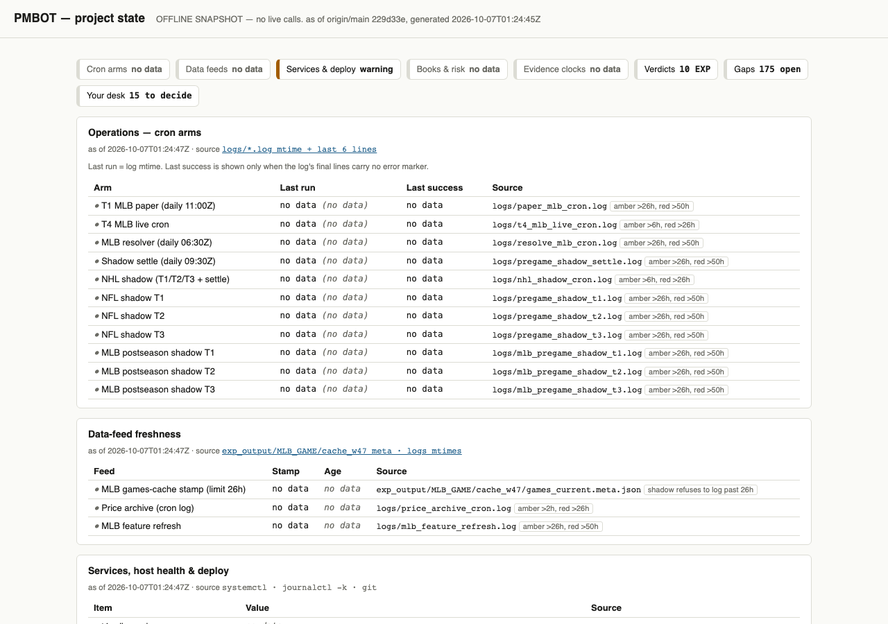
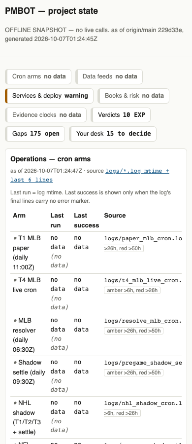
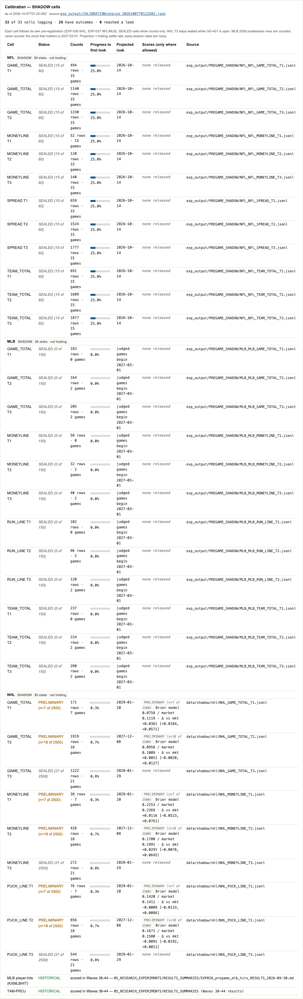
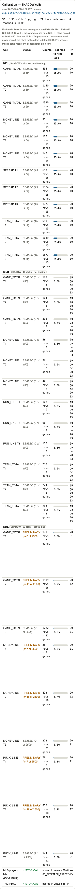

# W58.3 — The Calibration Engine: results

**Status:** DONE · Run 2026-10-07 · Tier STANDARD · Deliverable: one pre-registration-aware scoring pipeline for every shadow cell, shown on `/project`.
**PR:** #175, CI green (run 37557900216), merged as `f20f095`. Deploy run 37558544298: t4-mlb restart decision = `not_needed`.

## Part A — Engine
`src/prediction_market_bot/pregame_shadow/calibration_engine.py` + CLI `scripts/calibration_engine.py`. Builds on the `scoring.py` primitives (no fork); imports only `scoring` and the stdlib (the package AST safety test still passes).
Parameters live in one reviewed table (`PREREG`) with a citation per row: NFL EXP-037 (looks at 60 then 150), MLB EXP-037 (150 then 600; only games from 2027-03-01 judged), NHL EXP-036 (2,500; PRELIMINARY below; T3 sealed while GG-401 is open, unreadable GG state counts as open). Cells with no pre-registration get counts only. Historical families (player-hits, T4M-PROJ) are shown with their results citations.
Always output: rows, settled games, judged n, % to first look, projected first-look date. Where allowed: Brier model/climatology/market, delta-Brier with game-cluster CI (B=2000, seed 20261002), reliability bins, decomposition, fee-adjusted edge under both fee candidates. Sealed cells emit the literal `SEALED (n of judged n)` and **no score key**: the gate is inside `compute_scores`, not in the caller.

## Part B — Tests
`tests/test_calibration_engine.py`: sealed-cell leak incl. direct call; NFL look at 60; NHL PRELIMINARY label; NHL T3 sealed under GG-401 (unknown = open, resolved unseals); MLB postseason excluded; counts-only; known-answer Brier, CI, decomposition, bins; read-only run with the NHL ledger join; import check. Dashboard tests added in `tests/test_generate_project_state.py`.

## Part C — VPS run (read-only on ledgers)
Output `exp_output/CALIBRATION/engine_20261007T012250Z.json`. 33 cells, 33 logging, 29 with outcomes, **0 reached a look**. GG-401 open.

| Sport | Cells | Status | Count | Projected first look |
|---|---|---|---|---|
| NFL | 12 | SEALED | 15 of 60 each (25.0%) | 2026-10-14 |
| MLB | 12 | SEALED | 0 of 150 each (settled games 0 for T1, 2 for T2/T3, all postseason so not judged) | judged games begin 2027-03-01 |
| NHL T1 | 1 | PRELIMINARY | n=7 of 2500 | 2029-01-20 (low confidence) |
| NHL T2 | 1 | PRELIMINARY | n=18 of 2500 | 2027-12-08 (low confidence) |
| NHL T3 | 1 | SEALED | 21 of 2500 | 2028-01-29 or later |

No sealed score was read. NHL projections rest on only a few days of settle rate. NHL PRELIMINARY scores are shown labelled as such, which EXP-036 permits.

## Part D — Dashboard
Calibration section on `/project`: top line (logging / with outcomes / reached a look), per-sport rows, progress bar, projected date, scores only where allowed ("none released" otherwise), SHADOW · $0 stake tag, "no data" rather than zeros when no engine file exists. Screenshots (rendered from the VPS JSON):

| | Desktop | Phone |
|---|---|---|
| Before |  |  |
| After |  |  |

## Part E — Cron
One new line, block `W58.3-CALIBRATION`: `49 13 * * *` (off :00/:30 and off the staggered minutes), logs to `logs/calibration_engine_cron.log`. Crontab backed up before write (`/root/crontab.w58_3.pre.20261007T014540Z`) and re-read immediately before writing; diff = 3 lines added, 0 removed or changed. Mirrored (commented, additions only) into `deploy/cron.conf`.

## Registered, not fixed
- **GG-498** — `deploy/cron.conf` does not mirror the live EXP-037 and NHL blocks.
- **GG-499** — settled-row schemas differ by sport (no `p_clim` for MLB/NHL, no `game_key` for NHL, no MLB T1 settled file).

## Operator decisions
None blocking. Note for awareness: MLB/NHL climatology comparison is unavailable until settlement writes a climatology prior (GG-499).
