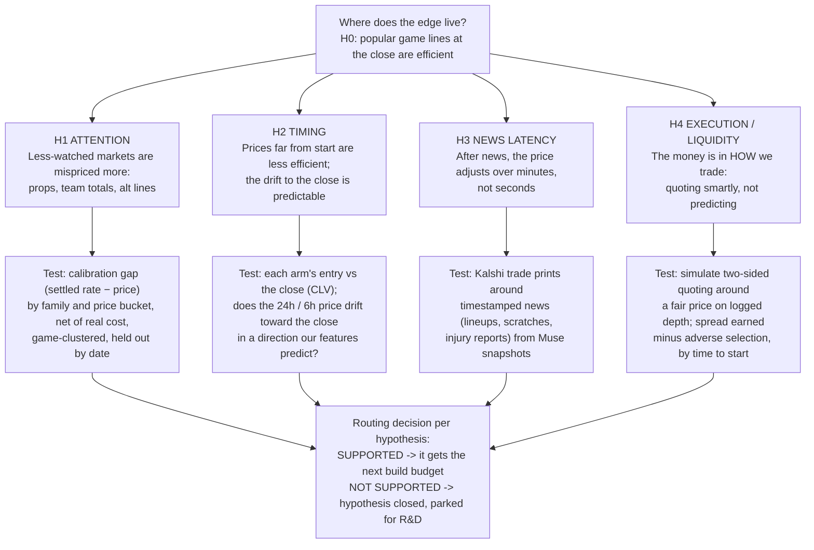

# Where does the edge live? — the edge-location hypothesis (pre-registration)

**Last reviewed:** 2026-11-20. **Status:** FROZEN at commit (this file's first commit) before any test below reads a result.
**Owner:** SW-9. **Operator:** "Okay put that hypothesis in a thorough diaphragm - let's put it to work" (2026-11-20 10:03 PT), after the
window's read (10:03 PT): "confident in the machine and the method, unsure about the edge."
Binding frame: DOCTRINE.md / ADR-0077 — every result here is a ROUTING result. A hypothesis that fails is closed and parked for R&D; no
cell, family or sport is ruled out by it.

## 1. What the evidence says so far (the premise, dated)

| Finding | Number | Source |
|---|---|---|
| Kalshi tracks the books at the NHL moneyline close | gap +0.16c, n 1,312 games; riding the books' side at ask −5.5c | W117.2 |
| Forecast edges per leaf are about zero | router v2 arms 0 leaves held out; first weekly look 0 arms on every map | W116.1, W121.1 |
| Resting orders are adversely selected | RIDE fills win 69% vs 83% unfilled; FADE 33% vs 38% | W116.2, W119.3 |
| Execution effects are large | fill vs non-fill win rates differ by 10-30 points | W116.2 |
| The best lead is a placement choice, not a forecast | FADE crossing +16.6c [−1.6, +34.8] / contract, 20 games | W117.1 |
| News timing at the NHL goalie is priced fast | lag 0.2c, n 14 | W118.3 |

**H0 (the null we start from):** on the popular game lines an hour before start, Kalshi is efficient, and our forecasts add nothing.

## 2. The four places the edge could be

## 3. Each hypothesis, pre-registered

### H1 — Attention
- **Claim:** mispricing grows as attention falls. Props, team totals and alternate lines show a larger net calibration gap than
  moneyline / spread / total.
- **Measure:** per family and price bucket, settled rate minus price, net of the real cost (spread logged or backfilled, Kalshi fee),
  game-clustered 90% intervals, held out by date (first 2/3 fit, last 1/3 judged). Where a free consensus exists (NHL 2025-26 now; NHL
  2026-27 from Monday), also Kalshi minus consensus.
- **Supported if:** at least one non-headline family has a held-out net gap whose interval excludes zero, AND the mean absolute net gap of
  the non-headline families exceeds the headline families'.
- **Not supported if:** no non-headline family's interval excludes zero, or the headline families' gap is as large.

### H2 — Timing
- **Claim:** prices far from start are less efficient, and their drift toward the close is predictable.
- **Measure:** (a) closing-line value of every arm order: entry price vs the last price before start, per arm, per hours-to-start
  bucket. (b) On the price archive: drift from 24h / 6h to the close, regressed on what we knew at 24h / 6h (our model p minus price;
  the consensus move where it exists). Game-clustered, held out.
- **Supported if:** the drift coefficient on our signal is positive with an interval excluding zero at 24h or 6h, and the implied CLV
  beats one round cost.
- **Not supported if:** the drift is unpredictable, or smaller than the cost.

### H3 — News latency
- **Claim:** after news lands, Kalshi takes minutes, not seconds, to reprice.
- **Measure:** Kalshi public trade prints (and the ~20-min archive where prints are missing) around timestamped news: NBA starting
  lineups and scratches, NFL inactives, injury reports (Muse snapshots carry post times). The price path from 30 min before to 30 min
  after; the size of the move still to come at +1 / +5 / +15 min.
- **Supported if:** a move larger than one round cost is still to come at +5 min, on at least 30 events, with an interval excluding zero.
- **Not supported if:** the move is done within a minute (as with NHL goalies, W118.3) or is smaller than the cost.

### H4 — Execution / liquidity
- **Claim:** the edge we can actually prove is in how we trade. Quoting both sides near a fair price earns the spread, minus adverse
  selection, and that is positive at some horizons and in some families.
- **Measure:** a simulation on logged depth (book at submit since 11-18; archive depth samples), quoting one tick inside around a fair
  price (the market's own mid, or the consensus where one exists), filled when the book trades through, scored to settlement. Adverse
  selection is measured from our real fills (fills vs non-fills) by family and hours to start.
- **Supported if:** simulated net per filled contract is positive with an interval excluding zero in at least one family x horizon,
  after the adverse-selection term measured on real fills.
- **Not supported if:** adverse selection eats the spread everywhere.
- **Note:** H4 tests a new way of trading (two-sided quoting). A live demo test of it is an operator decision and is not part of this
  pre-registration; this one is a simulation on data already logged.

## 4. Rules that bind all four
- Frozen before any result is read. A deviation is a dated addendum, written before the result it would change.
- One outcome per hypothesis: SUPPORTED / NOT SUPPORTED / UNDERPOWERED (state n and the n needed).
- Game-clustered intervals; never count orders or rows as independent.
- Costs are real: spread at submit where logged, backfilled otherwise, the Kalshi fee schedule.
- No real capital, kelly 0. Nothing here changes v1's live orders.

## 5. What each answer changes
| Result | Next build |
|---|---|
| H1 supported | Wiring priority moves to the supported families (props, team totals, alt lines) ahead of headline lines |
| H2 supported | The T1 band (12-48 h) gets the depth budget; arm entries move earlier |
| H3 supported | A news-reaction arm on the supported event type, fed by Muse's timestamped snapshots |
| H4 supported | A two-sided quoting arm proposed to the operator as a demo test (new trading mode) |
| All four not supported | The method holds and the edge is not in these markets at this scale; the operator decides scope (venue, market class) |

## 6. Addendum A (2026-11-20 ~20:25 UTC, W123.4) - H4 operationalization, written BEFORE any Part B result was computed
Part A fill counts (2,131 post-epoch arm orders, 157 fills) were seen; no simulated fill, markout or settlement outcome had been read.
The pre-registration above does not fix these details; they are fixed here and any later change is a further dated addendum.
1. **Horizon = hours to market close**, not to start. The price archive carries no game start time (only `close_time`); close is roughly
   start plus game length. Buckets: 0-2h, 2-6h, 6-24h, 24h+. Part A also reports hours-to-start buckets where the order logged them.
2. **Quotes.** Fair = the market's own mid (variant (a)). At every archive snapshot with a two-sided book and spread >= 3 ticks (1c), post
   YES bid = bid + 1c and YES ask = ask - 1c, one contract each. Spread 1-2 ticks: no inside price exists, no quote.
   Variant (b), consensus as fair: NOT RUN - no free consensus line overlaps the 2026-11-06+ archive window for NBA / NFL (NHL 2025-26
   is a prior season). Registered as a data limit.
3. **Fill rule.** A quote lives until the same ticker's next snapshot, and is judged only if that snapshot is <= 15 min later. The bid
   fills if the next snapshot's yes_ask <= our bid (the book traded through us); the ask fills if the next yes_bid >= our ask. Fill price =
   our quote (maker). Snapshots are ~3-8 min apart, so intra-interval trades are not seen: this is conservative on fills, not exact.
4. **Score.** Held to settlement (Kalshi `result`, public settled-market records). Fee = `quant.money.fee_rate(series, price, "maker")`.
   Net = settled P&L - fee - AS, with **AS** (adverse selection per filled contract) from Part A real fills: mean(won - limit price | unfilled,
   settled) - mean(won - limit price | filled, settled), per family x hours-to-close bucket; where a cell has < 10 real fills, the family
   pooled across buckets; where the family has none, all-families pooled, flagged. AS is subtracted as measured (not clipped at 0).
   The simulated fill rule already selects on price movement, so subtracting AS may double count: that makes the net conservative, and
   the gross-of-AS number is reported beside it. The verdict uses the NET number, as pre-registered.
5. **Unit and intervals.** Net per filled contract; game-clustered (game = event suffix after the series, e.g. 26NOV12CHAPHX); 2,000
   bootstrap draws, seed 20261120; 90% interval (as H1) with 95% shown. Cells with < 20 games are UNDERPOWERED, not judged.
   Many-cells control (HYPOTHESIS_DOCTRINE I.4.5): K = number of judged family x horizon cells is stated, and SUPPORTED needs a
   cell whose bootstrap one-sided p survives Benjamini-Hochberg at q = 0.10 across the K, as well as the interval excluding zero.
6. **Depth.** Quotes are 1 contract, first in queue at a new inside price level, so logged touch size does not bind and is not used.
   Fill SIZE beyond 1 contract is therefore not claimed.
